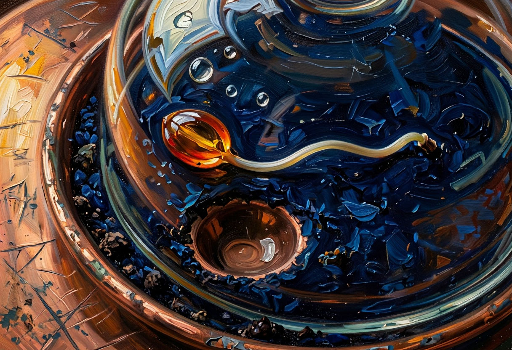

# Отчёт по работе «АХ: Агент-художник»

## Выполнили

- Аршинов Иван
- Барулева Кристина
- Губенков Илья
- Якунина Анна

Название проекта: **«Археология будущего — следы присутствия»**.
Дата выполненного эксперимента: 15 октября 2026 года.

## Мотивирующий абзац (Project Statement)

Мы представили музей 2126 года, где вместо смартфонов и серверов выставлены
материальные следы цифровых привычек. Уведомление стало немым колоколом,
непрочитанное сообщение — зерном, облачная память — гербарием, а несостоявшиеся
маршруты — рекой. Общая палитра меди, янтаря и глубокого синего связывает четыре
самостоятельных экспоната в одну коллекцию. Задача агентов — придумать видимую
метафору, а не просто добавить к слову «будущее» неон и роботов.

Необычность проекта — в проверяемом следе принятия решений. Куратор оспаривает
предложение художника, затем VLM рассматривает реальное изображение и предлагает
доработку. Мы сохраняем оба варианта и не объявляем вторую версию улучшением
автоматически: в трёх случаях она получила меньшую сумму оценок. Галерея позволяет
переключить версии и прочитать диалог. Дополнительная SD-Turbo показывает, как
тот же замысел меняется при переходе к локальным открытым весам и короткому
текстовому окну.

## Использование ИИ

Для разработки концепции, кода, сайта, проверок и первичного текста отчёта
использовался кодинг-агент **Codex**. Исходное задание сохранено в
[ai/INITIAL_PROMPT.md](ai/INITIAL_PROMPT.md), замысел — в [ai/IDEA.md](ai/IDEA.md),
инструкции по работе с репозиторием — в [AGENTS.md](AGENTS.md).
Персональное распределение выполненных действий между участниками здесь
не приписывается: автоматизированную реализацию и запуск сопровождал Codex.

В самой системе работают куратор DeepSeek, художник Qwen и визуальный критик
Qwen с отдельными ролями и входами. Художник и критик используют одну базовую
модель; их суждения не следует считать статистически независимыми.
Картины получены через Yandex Image Generation API, дополнительное изображение —
через локальную SD-Turbo. Реплики агентов, оценки и промпты в журнале не
переписаны вручную. Неудачные и оборванные ответы тоже сохранены.

## Принципы реализации

Полная реализация с пояснениями находится в [Agent_Artist.ipynb](Agent_Artist.ipynb).
Её синхронизируемый CLI-вариант — [agent_artist.py](agent_artist.py).

1. Куратор получает тему, вопрос и общую визуальную грамматику серии.
2. Художник отвечает композицией и промптом; куратор высказывает конкретное возражение.
3. Художник фиксирует первый промпт. Image Generation API создаёт изображение.
4. VLM получает **само изображение**, тему и рубрику. Переписка и промпт художника
   критику не передаются. Это помогает отличать обещанный образ от видимого.
5. Художник отвечает на замечания и пишет новый промпт. Создаются и оцениваются
   вторая версия и её полный журнал.
6. Выбирается максимальная сумма четырёх критериев по 1–5. При равенстве остаётся
   ранняя версия. Бюджет — ровно две версии на экспонат.

Responses API вызывается методом `client.responses.create`, изображения —
`client.images.generate` на `https://ai.api.cloud.yandex.net/v1`.
Для VLM PNG преобразуется в JPEG с максимальной стороной 1024 и передаётся
как `input_image`. Контрольные точки позволяют продолжить запуск после ошибки.
JSON проверяется до использования; для новых вызовов критика поддержана схема.
Сырой ответ сохраняется отдельно от разобранных полей.

Изменения промпта запускают **новый рендер**, а не редактируют пиксели старой
картины. Последовательность и зависимости видны в [DIALOGUES.md](DIALOGUES.md)
и отдельных JSON в [data/](data/).

## Результаты

Получены четыре картины, по две версии каждой; дополнительно — одна интерпретация
SD-Turbo. Таблица содержит **субъективные суммы оценок VLM**, максимум 20.

| Картина | Версия 1 | Версия 2 | Изменение | Выбранный финал |
|---|---:|---:|---:|---|
| Последнее уведомление | 17 | 15 | −2 | Версия 1 |
| Сад непрочитанных сообщений | 18 | 15 | −3 | Версия 1 |
| Облачный гербарий | 19 | 15 | −4 | Версия 1 |
| Река отменённых маршрутов | 16 | 18 | +2 | Версия 2 |

Средняя сумма первой версии — 17,5; второй — 15,75; выбранных финалов — 18.
Доработка выиграла в одном из четырёх случаев. Это наблюдение одного небольшого
прогона, а не статистический вывод об эффективности многоагентности.

### Последнее уведомление

Колокол и янтарная капля связывают привычку требовать внимания с остаточным
свечением после исчезновения адресата. Критик отметил убедительную материальность,
но спорную ясность метафоры. После доработки сумма снизилась с 17 до 15,
поэтому сохранился первый вариант. Полный разбор: [data/01-notification.json](data/01-notification.json).

### Сад непрочитанных сообщений

Замысел разговора, который не произошёл, воплощён через органический рост и
янтарное зерно в медной форме. Картина сохраняет общую палитру, но её связь
с непрочитанными сообщениями требует кураторского пояснения. Система выбрала
первую версию: 18 против 15. Журнал: [data/02-unread.json](data/02-unread.json).

### Облачный гербарий

Белые ветвящиеся структуры заперты между музейными стёклами: обещанная вечность
памяти превращается в хрупкий сохраняемый материал. Здесь получена наибольшая
сумма оценки первой версии — 19. Это мнение критика, а не объективное первое
место в коллекции. Журнал: [data/03-cloud.json](data/03-cloud.json).

### Река отменённых маршрутов

Единственный экспонат, для которого вторая версия получила большую сумму:
18 вместо 16. Тем самым отбор не сводится ни к обязательному принятию доработки,
ни к сохранению первой попытки. Оба промпта и рецензии доступны в
[data/04-routes.json](data/04-routes.json).

### Открытая модель с Hugging Face

Локально запущена [stabilityai/sd-turbo](https://huggingface.co/stabilityai/sd-turbo)
из открытых весов через Diffusers: 512×512, четыре шага, `guidance_scale=0`,
seed `2126`, устройство Apple MPS, вычисления float32. Revision и SHA-256
записаны в [data/openweight.json](data/openweight.json). **Powered by Stability AI**.

Отправлен тот же промпт, что для выбранного «Последнего уведомления». Из-за
короткого окна CLIP он обрезается: фактически использованный текст сохранён
в `effective_prompt`. Результат прочитывается скорее как патинированный
светильник; тонкая семантика музейного экспоната теряется. VLM поставила
15/20 против 17/20 облачной версии, но сравнение одного изображения при разных
разрешениях, окнах и бюджетах не доказывает превосходства одного рендерера.

### Галерея и техническая проверка

Статическая галерея в [docs/](docs/) создана кодинг-агентом. Она показывает все
четыре финала, переключает версии, раскрывает VLM-критику и полные диалоги,
содержит сравнение со SD-Turbo. Для публикации на GitHub Pages подготовлен
workflow [.github/workflows/pages.yml](.github/workflows/pages.yml).
Подготовленный workflow сам по себе не подтверждает успешную публикацию.

Ноутбук полностью выполнен в режиме просмотра сохранённого эксперимента.
В его ячейки встроены реальные изображения и ответы. Генерация при таком
просмотре отключена, поэтому проверяющий не расходует учебную квоту.
Скрипт `scripts/validate.py` подтвердил наличие четырёх работ, восьми версий,
правильность выбора, входы VLM, совпадение хешей изображений, синхронизацию
галереи и отсутствие ошибок в выполненных ячейках.

В журналах коллекции — 38 ответов Responses API, включая неудачные и
дополнительные VLM-попытки. Суммарный `usage` этих записей: 63 666 входных
и 48 154 выходных токена, всего 111 820. Это не полный биллинг: отдельные
проверки подключения и Image API в этот счётчик не включены. Стоимость
не оценивается без тарифов и фактических данных учебного аккаунта.

## Выводы

1. Разделение ролей полезно, когда оно меняет последующее действие: возражение
   куратора и VLM-рецензия действительно становятся входом нового промпта.
   Просто попросить одну модель «обсудить идею» было бы менее наблюдаемым протоколом.
2. Текстовое намерение не равно визуальному результату. VLM может увидеть
   декоративные элементы, которые генератор добавил сам, и заметить неясность
   метафоры. При этом её описания тоже бывают неточными и языково нестабильными:
   JSON-схема исправляет структуру, но не гарантирует содержательное качество.
3. Итерация не гарантирует улучшения: в трёх из четырёх случаев сумма снизилась.
   Поэтому нужны контрольные точки, сохранение альтернатив и заранее объявленное
   правило выбора. По этому прогону нельзя делать общий вывод о бесполезности
   или превосходстве обратной связи.
4. Открытые веса дают локальный управляемый рендерер, но требуют учитывать
   память, устройство, число шагов и длину окна токенизатора. Одинаковая строка
   промпта ещё не означает одинаковые условия эксперимента.
5. Совместимость API нужно проверять практически. Некоторые старые модельные
   алиасы из курса не доступны учебному ключу; доступная Qwen 3.6 возвращала
   оборванный JSON, пока для компактных ответов не был отключён режим рассуждений.
   Backend также вернул 1216×832 при запросе 1536×1024 — это отражено в метаданных.

Следующий шаг для исследовательского развития — несколько независимых критиков,
повторные запуски с разными seed и человеческое слепое сравнение при одинаковых
условиях. Независимая человеческая оценка в этой лабораторной не заявляется.

## Источники

- [Условие лабораторной и критерии](https://github.com/MAILabs-Education/Agent_Artist).
- [Официальный курс Yandex AI Studio](https://github.com/yandex-ai-studio/ai-studio-course).
- [Примеры Responses и Image Generation API](https://github.com/yandex-ai-studio/ai-studio-course/blob/main/1-intro-ai-studio/CloudConnect.ipynb).
- [Пример мультимодальной Qwen](https://github.com/yandex-ai-studio/ai-studio-course/blob/main/8-other-services/OCR.ipynb).
- [SD-Turbo: карточка модели и примеры](https://huggingface.co/stabilityai/sd-turbo).
